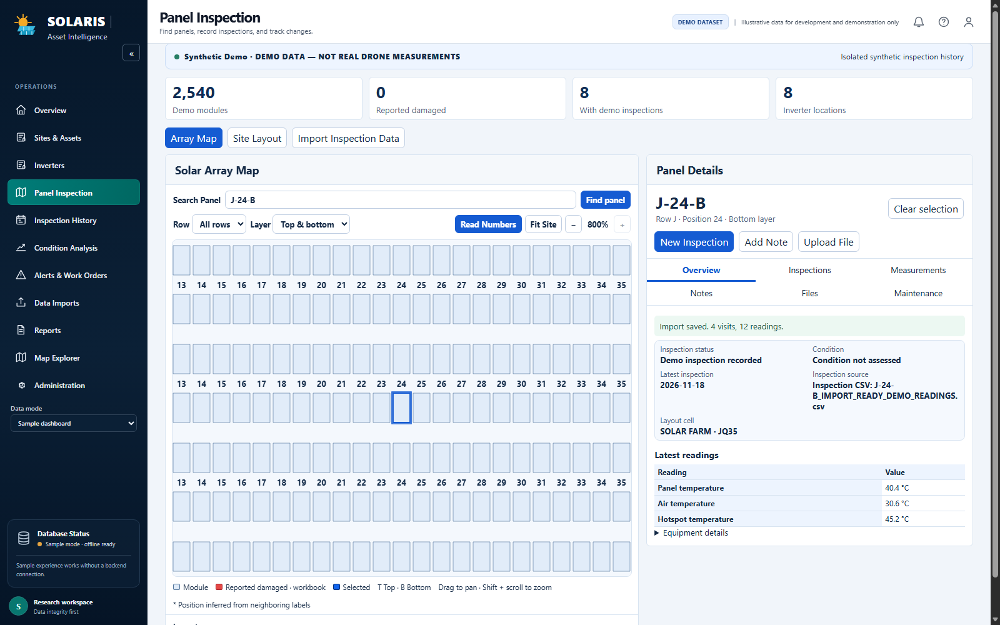

# SolarPV Shared Platform

Four-student solar PV monitoring research platform

## Run the SOLARIS Panel Inspection prototype

Use Windows PowerShell, Python 3.13+, Node.js 24+, and Microsoft Edge for browser verification. From this repository root:

```powershell
python -m venv .venv
.\.venv\Scripts\python.exe -m pip install -e ".[dev]"
npm.cmd --prefix frontend ci
powershell -ExecutionPolicy Bypass -File .\scripts\start_panel_demo.ps1
```

Open [http://127.0.0.1:5249](http://127.0.0.1:5249) and keep the launcher running. The API listens on loopback port 8049. The launcher seeds the illustrative layout and synthetic demo records. The demo persists under the ignored `.panel-demo/shared-review` directory, and the launcher prints the separate development database path.

### Demo

1. Open **Panel Inspection** in the sidebar. Search for `J-24-B` and click **Find panel**.
2. Click **Import Inspection Data → Choose File**, select [the synthetic J-24-B CSV](demo/J-24-B_IMPORT_READY_DEMO_READINGS.csv), and click **Preview CSV**.
3. Check **Confirm synthetic import** and click **Import inspections**. The first import saves **4 visits and 12 readings** and opens the same panel's Overview.
4. The latest visit is dated **2026-11-18**. Overview displays panel temperature **40.4 °C**, air temperature **30.6 °C**, and hotspot temperature **45.2 °C**. Refresh to check that the readings persist.
5. Repeat the import to see **0 new visits or readings**. Select **N-56-T** and preview the same CSV to see the panel mismatch.

The fixture contains simulated observations. The illustrative array provides stable panel IDs for the demo. **Upload File** attaches visit evidence. **Import Inspection Data** saves readings.



### Checks

```powershell
$env:SOLARPV_PANEL_WORKBOOK = "synthetic-demo"
.\.venv\Scripts\python.exe -m pytest -q
npm.cmd --prefix frontend test -- --maxWorkers=2 --testTimeout=25000
npm.cmd --prefix frontend run build
```

With a fresh disposable demo running, run `node scripts/verify_panel_inspection_browser.mjs 5249 --overview-check demo/J-24-B_IMPORT_READY_DEMO_READINGS.csv`. The check imports the file, refreshes Overview, retries the import, verifies the N-56-T mismatch, and confirms evidence upload.
